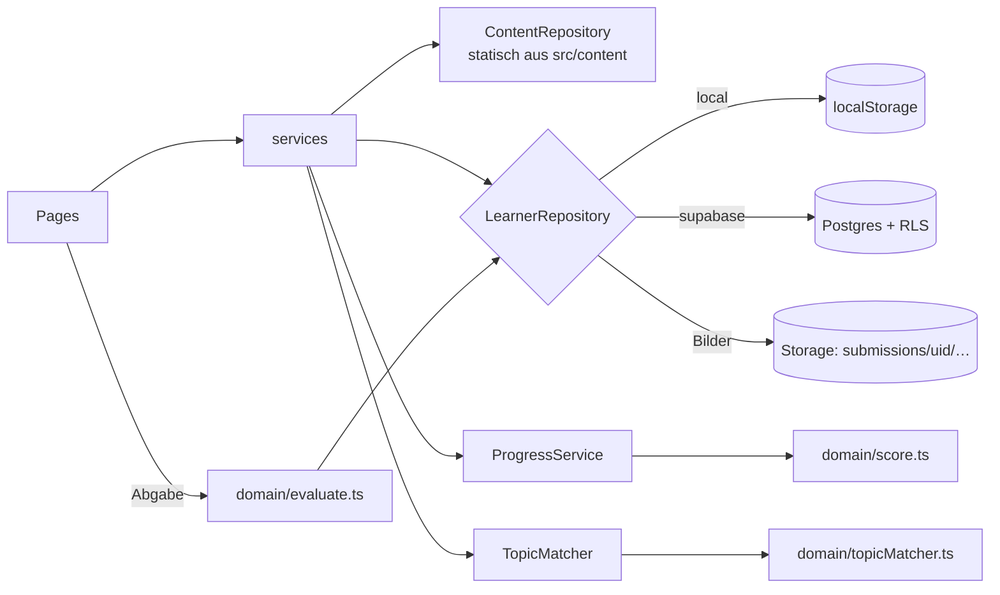
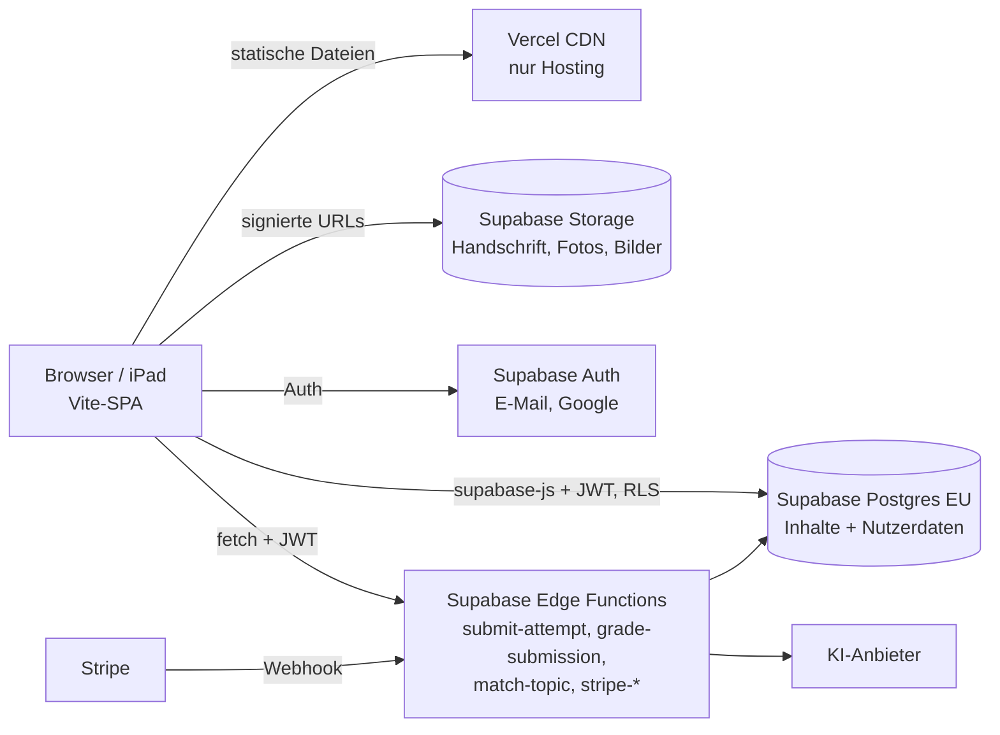

# Architektur – MatheMentor MVP

## 1. Überblick
Tablet-first Single-Page-App (React/Vite/TS). Lerninhalte sind eine **geprüfte, versionierte Wissensbasis** in `src/content` und werden nie von der KI erzeugt. Nutzerdaten liegen in Supabase/Postgres und sind per RLS geschützt. Ohne Supabase-Konfiguration läuft die App automatisch im **lokalen Modus** (localStorage + Mock-Auth), dann komplett ohne Cloud.
**Zielbild (beschlossen, noch nicht umgesetzt):** Nach dem lokalen MVP liegen *alle* relationalen Daten – Inhalte und Nutzerdaten – in Supabase, das SPA wird auf Vercel gehostet. Die TS-Dateien in `src/content` sind eine Übergangslösung. Plan und offene Fragen: **§12**.

## 2. Stack
| Bereich | Wahl | Begründung |
|---|---|---|
| UI | React 19, Vite 8, TypeScript (strict), Tailwind 4 | Vorgabe des Konzepts, schneller Build |
| Routing | react-router 7 | Standard, einfache verschachtelte Layouts |
| Mathe | KaTeX (`MathText`, Inline-`$…$`) | schnell, synchron, kein MathJax-Overhead |
| Backend | Supabase (Auth: E-Mail + Google, Postgres, Storage) | wenig Infrastruktur, RLS serverseitig |
| Tests | Vitest (Domain/Content), PGlite (`npm run db:check`, Schema + RLS) | ohne Cloud lauffähig |

## 3. Ordnerstruktur
```
src/
  types/        content.ts (Wissensbasis), learner.ts (Nutzerdaten), index.ts
  content/      Seed-Wissensbasis: pythagoras.ts (8 Kapitel), prozent.ts, quadratisch.ts, helpers.ts, content.test.ts
  domain/       REINE Logik ohne I/O: evaluate.ts (Antwortprüfung inkl. evaluateHandwriting), score.ts (Verständnis-Score), topicMatcher.ts,
                progressView.ts (Aufgabenstatus, nächstes Kapitel, Empfehlung, Labels)
  services/     types.ts (Interfaces), config.ts (Modus-Wahl), index.ts (Composition Root)
    shared/     staticContentRepository, progressService, topicMatcherService, attemptSubmissionService, draftStore (für beide Modi)
    local/      localAuthService, localLearnerRepository, storage (localStorage, Präfix mathmvp:v1:)
    supabase/   client, supabaseAuthService, supabaseLearnerRepository
  context/      AuthContext (Session)
  components/   AppLayout, ProtectedRoute, MathText, PageFallback, ProgressBar, StatusBadge, ScoreBadge,
                AnswerInputs (Choice/Numeric/MathInput), FeedbackPanel, SolutionView, Placeholder(Todo, derzeit ungenutzt)
    handwriting/ canvasModel.ts (REINE Strich-/Undo-Logik), renderStrokes.ts (Canvas-Rendering, PNG-Export), HandwritingCanvas.tsx
  pages/        Landing, Auth(login/register), Dashboard, Topic, Chapter, Exercise, History, Legal, NotFound
supabase/
  migrations/0001_init.sql   Schema, Grants, RLS, Storage-Bucket
  seed.sql                   ERZEUGT aus src/content via `npm run seed:sql`
scripts/  generate-seed.ts, check-db.mjs
```
**Regeln:** Seiten nutzen nur `services.*` und `domain/*`, nie Supabase oder localStorage direkt. `domain/` importiert nichts aus `services/` (abgesehen von Typen).

## 4. Routen
| Route | Seite | Schutz |
|---|---|---|
| `/` · `/login` · `/register` · `/legal/:page` | Landing, Auth, Impressum/Datenschutz/AGB | öffentlich |
| `/app` | Schüler-Dashboard | angemeldet |
| `/app/topics/:topicId` | Themen-Dashboard (Kapitel) | angemeldet |
| `/app/topics/:topicId/chapters/:subtopicId` | Lernkapitel | angemeldet |
| `/app/exercises/:exerciseId` | Aufgabe | angemeldet |
| `/app/history` | Aufgabenhistorie | angemeldet |

`ProtectedRoute` regelt nur die Navigation, Autorisierung passiert per RLS.

## 5. Datenfluss

Aufgabe abgeben: `evaluateAnswer(ex, raw)` → `learner.saveAttempt({…, correction, submission?})` → `progress.get*Progress()` berechnet den Score neu.

## 6. Service-Interfaces (`src/services/types.ts`)
- `AuthService`: `getSession`, `onAuthChange`, `signUpWithEmail` (gibt `null` zurück, wenn eine E-Mail-Bestätigung nötig ist), `signInWithEmail`, `signInWithGoogle`, `signOut`.
- `ContentRepository` (read-only): `listCurricula`, `listTopics` (TopicSummary), `getTopic`, `getSubtopic`, `getExercise`.
- `LearnerRepository` (immer auf `userId` beschränkt): `listActiveTopics`, `addActiveTopic`, `removeActiveTopic`, `saveAttempt`, `listAttempts(filter)`, `getAttempt`, `getSubmissionImageUrl`.
- `ProgressService`: `getSubtopicProgress`, `getTopicProgress`.
- `TopicMatcherService`: `match(query) → MatchResult` (`match` | `ambiguous` | `none`).
- `AttemptSubmissionService` (`services.attempts`): `submit(input) → SubmitResult`, `getPending`, `discardPending`. Ruft `learner.saveAttempt`; schlägt das fehl, wird die Eingabe über `DraftRepository` als Entwurf im Browser gesichert (`mathmvp:v1:draft:<userId>:<exerciseId>`, bei vollem Speicher ohne Bild). Der Entwurf wird **erst im Fehlerfall** geschrieben, damit er im lokalen Modus nicht den Speicherplatz der eigentlichen Abgabe belegt. Die Aufgabenseite stellt Entwürfe beim Öffnen wieder her und bietet „erneut senden“/„verwerfen“.
- **Modus-Wahl** (`config.ts`): Supabase wird genutzt, wenn `VITE_SUPABASE_URL` mit `http` beginnt und `VITE_SUPABASE_ANON_KEY` länger als 20 Zeichen ist. Mit `VITE_DATA_MODE=local` wird der lokale Modus erzwungen.
- **Entscheidung:** Der Content wird in beiden Modi statisch ausgeliefert, weil er klein, geprüft und offline-fähig ist. Die DB-Tabellen dienen für FKs, Tests und später Eltern/Lehrer. Ein Wechsel auf einen DB-gestützten `ContentRepository` ist eine reine Implementierungsänderung. **Übergangslösung**, wird in §12 (Schritte 3–4) abgelöst.

## 7. Datenmodell (`0001_init.sql`)
**A) Inhalte** (Text-Slug-IDs, für `authenticated` nur `SELECT`, schreiben darf nur `service_role`):
`curricula → topics → subtopics → {learning_materials, exercises → {solutions (1:1), hints (Level 1–3)}}`, dazu `tests → test_exercises` (sichtbar nur bei `review_status='approved'`).
**B) Nutzerdaten** (UUID, `user_id = auth.uid()`, kein Zugriff für `anon`):
- `profiles`: 1:1 zu `auth.users`, wird per Trigger angelegt, Rolle immer `student`. Der Client darf `role` nicht ändern (Column-Grant).
- `student_topics`: aktive Kacheln.
- `attempts`: **append-only**, kein UPDATE/DELETE. Ein Trigger prüft, dass `topic_id`/`subtopic_id` zur Aufgabe passen.
- `submissions` (+ privater Bucket `submissions/<uid>/<attemptId>.png`), `corrections` (Client darf nur `source ∈ {auto, self}` schreiben).
- `progress`: nur ein Snapshot/Cache. Die Wahrheit sind `attempts` + `score.ts`.
- `test_results`.
- `parent_child`, `teacher_student`, `subscriptions`: angelegt, Client darf **nur lesen (eigene Zeilen)**, geschrieben wird nur serverseitig.
Prüfung: `npm run db:check` (27 Checks: Schema, Seed-Idempotenz, RLS-Positiv/Negativ, Storage).

## 8. Topic-Matching (deterministisch, `domain/topicMatcher.ts`)
1. Normalisieren (Kleinschreibung, ä→ae, ß→ss, `%`→„prozent“, Satzzeichen entfernen), Stoppwörter entfernen.
2. Pro Thema: **+3** je Keyword-Phrase (mehrwortig, exakt), **+1** je Keyword-Token (Präfix-Toleranz ab 5 Zeichen), **+1** bei Treffer im Titel, **+0,5** je Token-Treffer im besten Kapiteltitel.
3. `match`, wenn bester Score ≥ 2 (oder ≥ 1 ohne Konkurrenz) **und** ≥ 1,5 × Zweitbester. Bei mehreren Treffern `ambiguous` (Top 3), sonst `none` mit Vorschlägen. Ein Thema wird **nie** neu erfunden.
4. **Später:** Bei `ambiguous`/`none` optional die Edge Function `match-topic` (KI) aufrufen. Sie bekommt nur die Liste `{id,title,keywords}` und darf nur vorhandene IDs zurückgeben, die serverseitig validiert werden.

## 9. Score-Formel (`domain/score.ts`, Konstanten in `SCORE_CONFIG`)
Pro Versuch: `credit = points × f`, mit `f = 0,25` wenn die Musterlösung vor der Abgabe angesehen wurde, sonst `f = 1 − 0,15 × hintsUsed` (0–3 Hinweise ⇒ 1 / 0,85 / 0,70 / 0,55).
Pro Aufgabe e (Stabilität): `q_e = 0,7 × credit(letzter) + 0,3 × credit(vorletzter)`. Bei nur einem Versuch ist `q_e = credit`, ohne Versuch `q_e = 0`.
Pro Kapitel:
- `M = Σ w_e·q_e / Σ w_e` über **alle** Aufgaben des Kapitels, mit `w = {1: 1, 2: 1,5, 3: 2}` je Schwierigkeit
- `T = |Typen mit q_e ≥ 0,6| / |Typen im Kapitel|`
- `roh = 100 × (0,8·M + 0,2·T)`
- **Deckel** (es gilt das Minimum): `T < 1` ⇒ **max. 79** · keine Aufgabe höchster Schwierigkeit mit q ≥ 0,8 gelöst ⇒ **max. 89** · keine Bestätigung (gleiche Aufgabe zweimal mit credit ≥ 0,8 im Abstand von ≥ 20 h) ⇒ **max. 94**
- `score = round(min(roh, Deckel))`
- Status: kein Versuch ⇒ `not_started` · score ≥ 80 und T = 1 ⇒ `mastered` · ≥ 2 Aufgaben bearbeitet und Ø q < 0,5 ⇒ `needs_practice` · sonst `in_progress`

Thema: `score = round(Ø Kapitel-Scores)` (ungewichtet), `completion = bearbeitete / alle Aufgaben`. Status: alle `not_started` ⇒ `not_started`, alle `mastered` ⇒ `mastered`, eins `needs_practice` ⇒ `needs_practice`, sonst `in_progress`.
Transparenz: `SubtopicProgress.caps` + `CAP_EXPLANATION` erklären dem Schüler die aktiven Deckel, `scoreBand()` liefert die Stufen aus Konzept §13. Testmodus-Attempts zählen im MVP genauso (Phase 2: eigene Gewichtung).

## 10. Erweiterungspunkte
| Feature | Ansatz |
|---|---|
| **Eltern** (Ph. 3) | Edge Function `link-child` (Einladungscode + Einwilligung) schreibt `parent_child`. SQL-Funktionen `is_approved_parent_of(uid)` und `is_approved_teacher_of(uid)` (security definer) bekommen zusätzliche SELECT-Policies auf `attempts`/`progress`. Dashboard liest `progress`-Snapshots. |
| **Lehrer** (Ph. 3) | analog über `teacher_student`, Gruppen zunächst über `group_name`, später eigene Tabelle `groups`. |
| **Foto-Upload** (Ph. 2) | `Submission.kind='photo'`, gleicher Bucket/Pfad. Zuschneiden/Vorschau im Client. Upload-Queue für Offline-Fälle (Entwurf in localStorage). |
| **KI-Korrektur** (Ph. 2) | Edge Function `grade-submission` mit Service-Key auf dem Server: lädt das Bild, ruft die KI auf und schreibt `corrections` (`source='ai'`, `marks` rot/gelb/grün je Schritt). Bei Unsicherheit `verdict='unclear'`, keine Bewertung. Danach sollen `answer`/`solutions` für Clients unsichtbar sein (Bewertung nur serverseitig). |
| **Stripe** (Ph. 3) | Checkout und Customer Portal über eine Edge Function, Webhook `stripe-webhook` schreibt `subscriptions`. Zugriffsprüfung über die SQL-Funktion `has_active_subscription(uid)` in den Policies bzw. Edge Functions. Keine Zahlungsdaten in der DB. |
| **Wiederholung/Empfehlung** (Ph. 4) | Bausteine sind schon da: `attempts.submitted_at` und der Deckel `no-confirmation`. Ein neuer Dienst `RecommendationService` berechnet den nächsten Schritt rein aus Domain-Logik. |

## 11. Annahmen und offene Punkte
- **Annahme:** Lehrplan „DE/Gymnasium Kl. 7–9“ orientiert sich an den KMK-Standards. Länderspezifische Varianten folgen über `curricula`. Die Inhalte brauchen noch eine fachliche Prüfung (`reviewStatus`).
- **Bekanntes MVP-Risiko:** `exercises.answer`/`solutions` sind für angemeldete Nutzer lesbar, und die Bewertung läuft im Client. Ein Schüler könnte also Lösungen auslesen oder Versuche fälschen, schadet damit aber nur dem eigenen Score. Ab Phase 2 wird die Bewertung serverseitig gemacht.
- In `localStorage` passen nur ca. 5 MB, Canvas-Bilder sollten deshalb verkleinert gespeichert werden (JPEG/WebP, ≤ 1200 px).
- Code-Splitting je Route (`React.lazy`): Hauptbundle ca. 350 kB (vorher 616 kB), KaTeX liegt in einem eigenen Chunk. Größter Rest im Hauptbundle: `@supabase/supabase-js` (wird auch im lokalen Modus geladen; später per dynamischem Import nur im Supabase-Modus).
- **Handschrift (Phase 1):** Bewertet wird nur das eingetippte Endergebnis (`evaluateHandwriting`). Der Rechenweg wird als PNG (≤ 1000 px) + Strichdaten gespeichert, aber nicht gelesen ⇒ immer gelbe Markierung „nicht automatisch geprüft“. Ohne Endergebnis bzw. bei unlesbarer Zahl: `unclear` ⇒ **kein Versuch gespeichert**, sondern Rückfrage (Konzept §8/§9).
- **Unklare Eingaben** (`verdict = 'unclear'`) werden generell nicht als Versuch gespeichert, damit sie den Score nicht senken.
- DSGVO/Einwilligung Minderjähriger, Speicherfristen und KI-Auftragsverarbeitung müssen vor dem Produktivbetrieb rechtlich geprüft werden.
- Die Score-Grenzen (§13) sind Produktentscheidungen und noch pädagogisch zu validieren.
- **Stand:** Lokales MVP freigegeben (DoD 1–10, Commit `4bd95eb`), BUG-01 … BUG-14 behoben und als Regressionstests abgesichert. Bewertungsregel: Mehrdeutiges ⇒ gelbe Rückfrage ohne gespeicherten Versuch (`evaluate.ts`, wird in Schritt 5 unverändert serverseitig genutzt).
- **Offene Entscheidungen (Req eng / Auftraggeber):** (1) `1.125` als Rückfrage bestätigen (`SINGLE_THOUSANDS_DOT_IS_AMBIGUOUS`); (2) Herleitungspfeile `→`/`⇒` und Ketten mit Einheitenwechsel werten statt Rückfrage?; (3) „keine Ahnung“ als Rückfrage statt Rot?; (4) Themen-Score nur über begonnene Kapitel mitteln (UX-06)?; (5) 3 Inhaltsfragen (erweiterte Antwortlisten, Teilpunkte bei `x > 0`); (6) F1–F10 aus §12.4.

## 12. Zielarchitektur & Migrationspfad (Supabase + Vercel)
**Status:** Entwurf, vom Auftraggeber vorgegeben (alles Relationale in Supabase, Hosting auf Vercel). Umsetzung erst, **wenn das lokale MVP fertig ist**. Bis dahin bleiben die TS-Dateien in `src/content`.

**Warum gibt es heute `src/content/*.ts`?** Sie sind (1) die Seed-Quelle für `supabase/seed.sql` und (2) der Datenbestand des lokalen Modus, mit dem die App ohne Cloud-Konto läuft und getestet wird (Vitest, E2E). Außerdem prüft der Compiler die Inhalte gegen die Typen. Eine *zweite* Wahrheit neben der DB soll das langfristig nicht sein.

### 12.1 Zielbild

| Komponente | Aufgabe |
|---|---|
| **Vercel** | Hostet nur das statische SPA (`dist/`), eine Umgebung pro Branch (Preview) und `main` (Production). Keine Geschäftslogik, keine Kinderdaten. |
| **Supabase Postgres** | Einzige Wahrheit für Lehrplan, Themen, Kapitel, Blöcke, Aufgaben, Lösungen sowie alle Nutzerdaten und Relationen (Eltern, Lehrer, Abos). |
| **Supabase Auth / Storage** | Konten (E-Mail, Google) bzw. private Bilder unter `submissions/<uid>/…`. |
| **Supabase Edge Functions** | Alle serverseitige Logik: Bewertung, KI-Korrektur, KI-Topic-Matching, Stripe Checkout/Portal/Webhook, Eltern-Verknüpfung. |

**Entscheidung: Serverlogik in Supabase Edge Functions, nicht in Vercel Functions.**
- Laufen in derselben EU-Region wie die DB; Kinderdaten verlassen die EU-Infrastruktur nicht (Vercel Functions laufen standardmäßig in den USA, `iad1`).
- JWT-Prüfung und `auth.uid()` sind eingebaut; der `service_role`-Key bleibt bei Supabase und muss nicht in Vercel hinterlegt werden.
- Vercel bleibt reines statisches Hosting und ist damit jederzeit austauschbar (z. B. Cloudflare Pages).
- Nachteil: Deno-Laufzeit und CPU-Zeitlimit pro Aufruf. Für KI-Aufrufe unkritisch, weil dort hauptsächlich auf I/O gewartet wird. Stripe hat ein Deno-taugliches SDK.

### 12.2 Datengetriebenes Inhaltsmodell (Entwurf, Migration `0002_content_blocks.sql`)
Beantwortet die Frage nach einer **Default-Seite + Beschreibung pro Thema/Kapitel in der DB**. Bereits in `0001` vorhanden: `topics.description/keywords/position`, `subtopics.description/objective/position`. Neu:

| Tabelle / Feld | Inhalt |
|---|---|
| `subtopics.kind` | Kapiteltyp `lesson` (Erklären + Üben, Default) · `practice` (nur Übung) · `test` (Test, ohne Hinweise/Lösung) · `review` (Wiederholung, darf Aufgaben anderer Kapitel desselben Themas nutzen) |
| `subtopic_blocks` | `id`, `subtopic_id` (FK), `position` (unique je Kapitel), `block_type`, `content jsonb`, `CHECK (validate_block(block_type, content))` |
| `page_templates` | `chapter_kind`, `blocks jsonb` = Standard-Reihenfolge, z. B. für `lesson`: intro → rules → video → example → exercise_set → summary |

**Blocktypen und `content`-Schema** (Texte: Markdown mit `$…$` für KaTeX):
| `block_type` | `content` |
|---|---|
| `intro` | `{ text }` |
| `rules` | `{ items: [{ term, explanation, math? }] }` |
| `video` | `{ title, provider: 'own'│'youtube'│'external'│'placeholder', url: string│null, durationSec?, captionsUrl? }`; `url = null` ⇒ Platzhalter „Video folgt“ |
| `example` | `{ problem, steps: [{ text, math? }], result }` |
| `exercise_set` | `{ title?, exerciseIds: string[] }` **oder** `{ title?, filter: { types?: ExerciseType[], difficulty?: (1│2│3)[], limit? } }`. Aufgaben bleiben in `exercises` (relational, FK von `attempts`); ein Trigger prüft, dass die IDs existieren. |
| `summary` | `{ items: string[] }` |
| `text` | `{ markdown }` |
| `image` | `{ storagePath │ url, alt (Pflicht), caption? }` |

- **Validierung** in Postgres über eine `immutable`-Funktion `validate_block()` (reines PL/pgSQL mit `jsonb_typeof`-Prüfungen). Bewusst nicht `pg_jsonschema`, damit `npm run db:check` (PGlite) weiter funktioniert. Im Client prüft dieselben Regeln ein Typ-Guard pro Block.
- **Rendering:** Die generische `ChapterPage` hat einen festen Rahmen (Titel, Lernziel, Score, Status, Deckel-Erklärung; diese Werte sind nutzerbezogen und daher keine Blöcke). Darunter werden die Blöcke über eine **Block-Registry** `components/blocks/<type>Block.tsx` gerendert. Unbekannte Typen ⇒ neutraler Fallback, kein Absturz.
- **Default-Seite:** Hat ein Kapitel keine eigenen Blöcke, wird das `page_templates`-Template seines `kind` mit den vorhandenen Daten gefüllt. `0002` überführt die bestehenden Spalten (`intro`, `rules`, `example`, `summary`, `learning_materials`) per `INSERT … SELECT` in Blöcke; `0003` entfernt die Alt-Spalten erst, wenn nichts mehr darauf zugreift.
- **Neues Thema ohne Code-Änderung:** Zeilen in `topics` → `subtopics` → `subtopic_blocks` + `exercises/solutions/hints` anlegen, `review_status = 'approved'` setzen. Fertig.
- **RLS:** wie heute; `authenticated` darf nur lesen, schreiben nur `service_role` bzw. später eine Rolle `editor`.

### 12.3 Migrationsschritte
| # | Schritt | Fertig, wenn |
|---|---|---|
| 1 | **Lokales MVP fertig** (DoD §25, E2E grün) | Tester-Abnahme |
| 2 | **Supabase-Projekte** `staging` + `prod` in der EU-Region (Frankfurt) anlegen, `0001` anwenden, `seed.sql` aus den TS-Dateien einspielen, Auth (E-Mail, Google) konfigurieren | App läuft im Supabase-Modus gegen `staging`; `db:check` und E2E grün |
| 3 | **`0002_content_blocks`** + Typen (`ContentBlock` als Discriminated Union) + generische `ChapterPage` mit Block-Registry; neuer `supabaseContentRepository` liest Inhalte aus der DB (Cache pro Sitzung) | E2E unverändert grün, lokaler Modus nutzt denselben Code-Pfad |
| 4 | **DB wird die Wahrheit für Inhalte.** Pflege per Redaktionsweg (siehe Frage F5); `src/content/*.ts` entfällt. Für lokalen Modus und Tests erzeugt `npm run content:export` einen JSON-Snapshot aus der DB, der per dynamischem Import geladen wird (nicht im Hauptbundle) | keine statischen Inhalts-Imports mehr in `src/` |
| 5 | **Bewertung serverseitig:** `answer`, `solutions`, `common_mistakes` wandern in eine Tabelle `exercise_keys` ohne Leserecht für Clients. Edge Function `submit-attempt` bewertet und schreibt `attempts`/`corrections`; `get-hint` und `get-solution` liefern Hinweise bzw. Lösung aus und protokollieren `hintsUsed`/`solutionViewed` serverseitig. Client-`INSERT` auf `attempts` wird entzogen | Score ist nicht mehr manipulierbar, Lösungen nicht vor der Abgabe abrufbar |
| 6 | **Vercel-Deployment:** Preview-Deployments ↔ `staging`, Production ↔ `prod`, Env-Variablen je Umgebung, Supabase-Redirect-URLs für Vercel-Domains, GitHub Actions (tsc, Vitest, `db:check`, E2E) vor dem Merge | Produktions-URL live, Preview pro Pull Request |

Die Schritte 2 und 6 sind unabhängig vom Inhaltsumbau und können vorgezogen werden (z. B. eine Demo auf Vercel im lokalen Modus).

**Lokaler Modus:** bleibt erhalten, als **Entwicklungs-, Test- und Demo-Modus** (schnelle E2E-Tests ohne Cloud, Offline-Demos). Ab Schritt 6 wird er in Produktions-Builds nur noch mit explizitem `VITE_DATA_MODE=local` aktiv; fehlt die Supabase-Konfiguration in Production, zeigt die App einen Konfigurationsfehler statt still Kinderdaten im Browser zu speichern.

### 12.4 Einwände & offene Fragen an den Auftraggeber
Grundsätzlich **kein Einwand**: Supabase + Vercel passt zu Konzept §20 und hält den Betriebsaufwand klein. Folgende Punkte sollten aber bewusst entschieden werden:

| Punkt | Einschätzung |
|---|---|
| **DSGVO / Kinderdaten** | Supabase-Region EU; AVV (DPA) mit Supabase, Vercel und dem KI-Anbieter nötig. Vercel ist ein US-Anbieter, verarbeitet bei reinem Hosting aber nur Zugriffsdaten (IP-Logs) – ein Grund, Serverlogik nicht auf Vercel zu legen und Vercel Analytics nicht ungeprüft einzuschalten. Einwilligung unter 16 Jahren (Art. 8 DSGVO) betrifft schon die Registrierung. |
| **Kosten / Free-Tiers** (Stand vor Umsetzung prüfen) | Supabase Free pausiert Projekte nach ca. 1 Woche Inaktivität, hat keine automatischen Backups und begrenzten Storage (ca. 1 GB ≈ einige Tausend Handschrift-Bilder). **Vercel Hobby ist nur für nicht-kommerzielle Nutzung erlaubt**; ein Abo-Produkt braucht Vercel Pro oder z. B. Cloudflare Pages. Für den Livebetrieb realistisch: Supabase Pro + Vercel Pro (je ca. 20–25 USD/Monat). |
| **Vendor-Lock-in** | Mittel: Schema, RLS und SQL sind Standard-Postgres (Migrationen im Git). Supabase-spezifisch sind Auth, Storage und Edge Functions; gekapselt in `services/supabase` und `supabase/functions`. Vercel ist austauschbar. |
| **Lösungen im Client lesbar** | Bis Schritt 5 kann ein angemeldeter Schüler Musterlösungen über die API auslesen und seinen eigenen Score fälschen. Für eine geschlossene Beta vertretbar, für den Livebetrieb nicht. |
| **Videos** | Eigene Videos im Supabase Storage verursachen viel Traffic; YouTube-Einbettung ist datenschutzkritisch (nur `youtube-nocookie` + Einwilligung). |

**Fragen (bitte jeweils kurz beantworten):**
- **F1** Supabase-Region **EU (Frankfurt)**? *Ja / Nein* – Empfehlung: Ja.
- **F2** Serverlogik in **Supabase Edge Functions** (Empfehlung) oder in **Vercel Functions**?
- **F3** Zwei Supabase-Projekte (**staging + prod**) statt einem? *Ja / Nein* – Empfehlung: Ja.
- **F4** Ab Go-Live **bezahlte Tarife** (Supabase Pro + Vercel Pro, alternativ Cloudflare Pages statt Vercel)? *Ja / Nein / Alternative*
- **F5** Wie werden Inhalte gepflegt? *(a)* Redaktions-UI in der App · *(b)* Supabase Table Editor · *(c)* JSON-Dateien im Git mit Review, Import per Skript in die DB. Empfehlung: zuerst *(c)* (Vier-Augen-Prüfung, Versionierung), *(a)* später.
- **F6** Wer gibt Inhalte fachlich frei (`review_status = 'approved'`)? *Person/Rolle benennen.*
- **F7** Ist die clientseitige Bewertung bis Schritt 5 für eine **geschlossene Beta** akzeptabel? *Ja / Nein*
- **F8** Lokalen Modus als Dev/Test/Demo **behalten** und in Production sperren? *Ja / Nein* – Empfehlung: Ja.
- **F9** Video-Hosting: *eigenes (Storage/Bunny/Vimeo)* oder *YouTube-nocookie mit Einwilligung*?
- **F10** KI-Anbieter: Anforderungen „Verarbeitung in der EU / keine Speicherung / kein Training“ verbindlich? *Ja / Nein*
