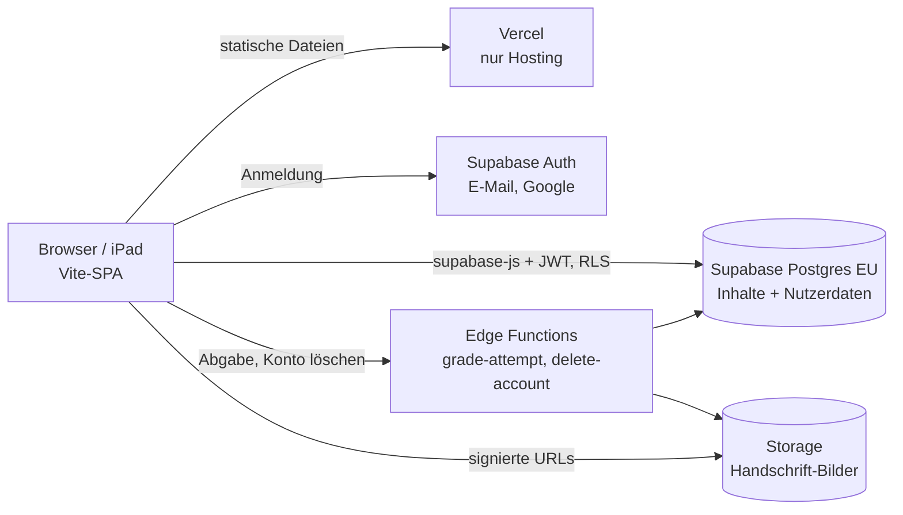

# Architektur – MatheMentor

## 1. Überblick
Tablet-first Single-Page-App (React/Vite/TS) für Mathe Klasse 7–9. Lerninhalte sind eine **geprüfte, versionierte Wissensbasis** in `src/content` und werden nie von einer KI erzeugt.



- **Supabase-Modus (Produktion):** Inhalte und Nutzerdaten liegen in Postgres, geschützt per RLS. Der Browser kennt keine Lösungen. Bewertet wird in der Edge Function `grade-attempt`, Hinweise und Musterlösung gibt es nur über protokollierende RPCs (§5).
- **Lokaler Modus (Entwicklung, E2E, Demo):** ohne Supabase-Konfiguration; localStorage und Mock-Auth, gleiche Regeln im Browser. Production-Builds verlangen dafür ausdrücklich `VITE_DATA_MODE=local`, sonst zeigen sie einen Konfigurationsfehler, statt Kinderdaten still im Browser zu speichern.

## 2. Stack
| Bereich | Wahl |
|---|---|
| UI | React 19, Vite 8, TypeScript (strict), Tailwind 4, react-router 7 |
| Mathe | KaTeX (`MathText`, Inline-`$…$`) |
| Backend | Supabase: Auth (E-Mail + Google), Postgres, Storage, Edge Functions (Deno), Region Frankfurt |
| Hosting | Vercel (nur statische Dateien, Security-Header in `vercel.json`) |
| Tests | Vitest (Domain/Content/Services), PGlite (`npm run db:check`: Schema, RLS, RPCs), Deno (`npm run test:functions`), Playwright (E2E, iPad); alles in CI |

## 3. Ordnerstruktur
```
src/
  config/       brand.ts (Produktname), legal.ts (CONSENT_VERSION)
  types/        content.ts (Exercise = öffentlich, ExerciseKey = Lösungsschlüssel, Authored* = Wissensbasis), learner.ts
  content/      Wissensbasis (prozent, pythagoras, quadratisch), publicView.ts (entfernt Lösungen)
  domain/       reine Logik ohne I/O: evaluate.ts (Antwortprüfung), score.ts, topicMatcher.ts, progressView.ts, gradingContract.ts
  services/     types.ts (Interfaces), config.ts (Modus-Wahl), index.ts (Composition Root)
    shared/  local/  supabase/   Implementierungen je Modus
  context/ components/ pages/
supabase/
  migrations/   0001_init.sql (Schema, RLS), 0002_production.sql (Lösungsschutz, RPCs, Einwilligung)
  seeds/        content-<prüfsumme>.sql, ERZEUGT aus src/content (`npm run seed:sql`)
  functions/    grade-attempt, delete-account (index.ts = Verdrahtung, handler.ts = Logik + Tests)
    _shared/    domain/ + types/ KOPIERT aus src (`npm run functions:sync`)
  config.toml   Auth-Einstellungen (`supabase config push`)
```
**Regeln:** Seiten nutzen nur `services.*` und `domain/*`, nie Supabase oder localStorage direkt. `domain/` importiert nichts aus `services/`. Die Bewertungslogik gibt es genau einmal (`src/domain/evaluate.ts`); die Edge Function nutzt eine Kopie, deren Gleichstand CI prüft.

## 4. Routen
| Route | Seite | Schutz |
|---|---|---|
| `/`, `/login`, `/register`, `/forgot-password`, `/reset-password`, `/legal/:page` | Landing, Anmeldung, Passwort, Rechtstexte | öffentlich |
| `/app` | Dashboard | angemeldet |
| `/app/topics/:topicId` · `…/chapters/:subtopicId` | Thema · Lernkapitel | angemeldet |
| `/app/exercises/:exerciseId` | Aufgabe | angemeldet |
| `/app/history` | Verlauf | angemeldet |
| `/app/account` | Konto: Passwort, Datenexport, Konto löschen | angemeldet |

`ProtectedRoute` regelt nur die Navigation, autorisiert wird per RLS. Ohne aktuelle Einwilligung (`profile.consentVersion ≠ CONSENT_VERSION`, z. B. erste Google-Anmeldung) zeigt sie zuerst die Einwilligungsseite.

## 5. Bewertung und Hilfen
Kernidee: **Der Score lässt sich nicht fälschen, und die Lösung ist vor der Abgabe nicht abrufbar, ohne dass es zählt.**

1. Der Client lädt Aufgaben **ohne** Antwort, Hinweise, Musterlösung und typische Fehler (`Exercise` mit `answerFormat`).
2. Hinweise (`reveal_hint`, nur der Reihe nach) und Musterlösung (`reveal_solution`) werden einzeln angefordert und pro Nutzer und Aufgabe in `exercise_sessions` vermerkt. `get_exercise_session` zeigt sie nach dem Neuladen wieder an.
3. Abgabe: `services.attempts.submit()` → Edge Function `grade-attempt` → `evaluate.ts` → bei `unclear` nur Rückfrage, nichts gespeichert → sonst `record_graded_attempt()`. Das übernimmt die vermerkten Hilfen in den Versuch, speichert Korrektur und Bild atomar und beendet die Bearbeitung.
4. Die Antwort enthält die Lösung zum Nachlesen. Im Verlauf liefert `get_exercise_review` sie nur bei eigenem Versuch.
5. Schlägt das Speichern fehl (Netz, Speicher voll), sichert `attemptSubmissionService` die Eingabe als Entwurf im Browser. Die Aufgabenseite bietet dann „erneut senden“ oder „verwerfen“ an.

Lokal setzt `localGradingService` dieselben Regeln im Browser um.

**Rechenweg (Schreibfläche oder Foto):** Bei allen Aufgaben außer Multiple Choice gibt es ein Schreibblatt (Aufgabe, Hinweis-Button, Werkzeugleiste, Kästchenpapier; Vollbild möglich) und **kein Ergebnisfeld**: Die KI liest das Endergebnis aus der Handschrift (`finalAnswerRead`), bewertet wird es deterministisch mit `evaluate.ts`. Ohne KI (nicht freigeschaltet, Fehler) oder bei unsicherer Lesung gibt es eine gelbe Rückfrage (`READ_MESSAGES`), es wird nichts gespeichert. Nur im lokalen Modus (keine KI) wird das Ergebnis eingetippt. Statt zu schreiben kann man ein Foto aus dem Heft hochladen (`components/handwriting/photo.ts`: verkleinert, Graustufen, Kontrast relativ zur Papierhelligkeit, als PNG unter dem Upload-Limit; `Submission.kind = 'photo'`, gleicher Bucket und Pfad). Bewertet wird das eingetippte Endergebnis (`evaluateSubmission`); ein mitgeschickter Rechenweg wird als PNG (Schreibfläche ≤ 1000 px plus Strichdaten, Foto ≤ 1600 px) gespeichert und gelb als „nicht automatisch geprüft“ markiert.

**KI-Korrektur (Phase 2, Prototyp):** Für Nutzer in `AI_GRADING_USERS` schickt `grade-attempt` Bild, Aufgabe und Musterlösung an Gemini (`services/ai/geminiGrader.ts`, Prompt und Prüfung der Antwort in `domain/aiGrading.ts`). Ist die Antwort lesbar, beurteilbar und sicher genug (`AI_GRADING_CONFIG.minConfidence`), ersetzt `withAiWork` die gelbe Markierung durch Markierungen je Schritt. Punkte und Urteil kommen weiterhin nur aus dem Endergebnis; Fehler oder Zeitüberschreitung (25 s) lassen den Rechenweg gelb, die Abgabe gelingt trotzdem. Die Korrektur wird derzeit mit `source = 'auto'` gespeichert.

## 6. Datenmodell
**Inhalte** (Text-Slug-IDs; Clients dürfen nur lesen, schreiben darf nur `service_role` über den Inhalts-Seed):
`curricula → topics → subtopics → {learning_materials, exercises → {exercise_keys, solutions, hints}}`, dazu `tests → test_exercises` (Phase 2).
`exercise_keys`, `solutions` und `hints` sind für Clients **nicht lesbar**, Themen mit `review_status = 'draft'` sind unsichtbar.

**Nutzerdaten** (UUID, an `auth.users` mit `on delete cascade`, kein Zugriff für `anon`):
| Tabelle | Inhalt / Regel |
|---|---|
| `profiles` | per Trigger angelegt; Rolle immer `student` (Client darf sie nicht ändern); Einwilligung `consent_version`, `consented_at` |
| `student_topics` | aktive Themen-Kacheln (Client darf schreiben) |
| `attempts`, `corrections`, `submissions` | Client darf nur lesen; geschrieben nur über `record_graded_attempt()` (nur `service_role`) |
| `exercise_sessions` | laufende Bearbeitung (genutzte Hilfen); nur über RPCs beschreibbar |
| Bucket `submissions/<uid>/<attemptId>.png` | privat, nur PNG ≤ 1,5 MB; Upload nur durch die Edge Function, Lesen per signierter URL |
| `progress`, `test_results`, `parent_child`, `teacher_student`, `subscriptions` | angelegt für spätere Phasen; Client darf höchstens eigene Zeilen lesen |

## 7. Score-Formel (`domain/score.ts`, Konstanten in `SCORE_CONFIG`)
Pro Versuch: `credit = points × f`, mit `f = 0,25`, wenn die Musterlösung vor der Abgabe angesehen wurde, sonst `f = 1 − 0,15 × hintsUsed` (0–3 Hinweise ⇒ 1 / 0,85 / 0,70 / 0,55).
Pro Aufgabe e (Stabilität): `q_e = 0,7 × credit(letzter) + 0,3 × credit(vorletzter)`. Bei nur einem Versuch ist `q_e = credit`, ohne Versuch `q_e = 0`.
Pro Kapitel (Aufgabenpool, niemand muss alle Aufgaben bearbeiten):
- `M = Σ w_e·q_e / max(Σ w_e, Z)` über die **zuletzt bearbeiteten 15 Aufgaben** (Fenster), mit `w = {1: 1, 2: 1,5, 3: 2}` je Schwierigkeit (× 1,5, wenn der letzte Versuch aus einem Kapitel-Test stammt, `testWeight`) und Zielgewicht `Z = min(12, Gewicht aller Aufgaben)` (≈ 8 gemischte Aufgaben; kleine Kapitel: alle Aufgaben). Alte Fehler fallen so aus dem Fenster.
- `T = |Anforderungsarten mit q_e ≥ 0,6| / |Anforderungsarten im Kapitel|` (Wissen, Rechnen, Sachaufgabe, Begründen, Zeichnen & Ablesen)
- `roh = 100 × (0,8·M + 0,2·T)`
- **Deckel** (es gilt das Minimum): `T < 1` ⇒ **max. 79** · keine Aufgabe höchster Schwierigkeit mit q ≥ 0,8 gelöst ⇒ **max. 89** · keine Bestätigung (gleiche Aufgabe zweimal mit credit ≥ 0,8 im Abstand von ≥ 20 h) ⇒ **max. 94**
- `score = round(min(roh, Deckel))`, `completion = min(1, Gewicht der bearbeiteten Aufgaben / Z)`
- Status: kein Versuch ⇒ `not_started` · score ≥ 80 und T = 1 ⇒ `mastered` · ≥ 2 Aufgaben bearbeitet und Ø q im Fenster < 0,5 ⇒ `needs_practice` · sonst `in_progress`

Thema: `score = round(Ø Kapitel-Scores der begonnenen Kapitel)` (ungewichtet; ohne begonnenes Kapitel 0), `completion = Ø Kapitel-completion` über alle Kapitel. Status: alle `not_started` ⇒ `not_started`, alle `mastered` ⇒ `mastered`, eins `needs_practice` ⇒ `needs_practice`, sonst `in_progress`.
Die aktiven Deckel erklärt `CAP_EXPLANATION` dem Schüler.

### Aufgabenpools und adaptives Üben (`domain/exerciseSelection.ts`)
Kapitel haben 50–100 Aufgaben. Geübt wird mit „Nächste Aufgabe“; `nextExercise` wählt:
- **Stufe**: Start bei Schwierigkeit 1; 3 gelöste Aufgaben in Folge (credit ≥ 0,8) ⇒ eine Stufe höher, 2 Fehlschläge in Folge (credit < 0,5) ⇒ eine Stufe tiefer.
- **Reihenfolge**: neue Aufgaben der Stufe → nicht gelöste der Stufe nach ≥ 20 h → neue der leichteren Stufe → nicht gelöste der Stufe → neue der schwereren Stufe → am längsten nicht gesehene. Innerhalb einer Gruppe wird eine zuletzt seltene Anforderungsart bevorzugt; Gleichstand per Zufall mit Seed „Nutzer + Tag“.
- Ab Score 80 empfiehlt die App das nächste Kapitel.

**Inhalte** (je Thema ein Ordner: `basis.ts` bzw. Kapiteldateien, `pool.ts`, `checks.ts`): Handgeschriebene Aufgaben (Wissen, Begründen, Sachaufgaben) plus **Aufgabenvorlagen** (`src/content/templates.ts`), die beim Build viele Varianten mit gerechneten Antworten und Lösungsschritten erzeugen. Deterministisch (Seed = Vorlagen-ID), IDs stabil (`lf-st-graph-01`). Eine Vorlage nachträglich inhaltlich zu ändern, ändert alle ihre Aufgaben – dann lieber eine neue Vorlage anlegen. `content.test.ts` prüft je Pool-Kapitel: ≥ 50 Aufgaben, alle Stufen (je ≥ 8), ≥ 3 Anforderungsarten, ≥ 20 % Sachaufgaben, keine doppelten Texte, jede Soll-Antwort wird als richtig gewertet, LaTeX-Backslashes vollständig.

**Schweregrad je Land/Schulart** (`domain/levels.ts`): `difficulty` gilt für NRW-Gymnasium; `levels` enthält Abweichungen `{ state?, schoolType, difficulty | null }` (`null` = dort nicht anbieten). Das Content-Repository löst den Wert für den Lernenden auf (vorerst fest NRW-Gymnasium; `profiles.state`/`school_type` sind angelegt).

### Lernpfad (`domain/learningPath.ts`)
Jedes Kapitel folgt demselben Schema mit einem Hauptbutton je Bildschirm: **1. Einstieg** (Lernziel, Video) · **2. Erklärung** (Regeln, Beispiel schrittweise) · **3. Formel-Check** (3 Aufgaben mit `checkpoint`, Formel vor Begriff) · **4. Erste Übungen** (3 leichte Rechenaufgaben) · **5. Üben** (`nextExercise`) · **6. Geschafft** (Score ≥ 80, Zusammenfassung, nächstes Kapitel).
- Der Schritt wird aus den Versuchen abgeleitet (keine eigene Tabelle). „Einstieg/Erklärung gesehen bzw. übersprungen“ merkt sich der Browser (`pages/pathStorage.ts`), im Supabase-Modus zusätzlich die Tabelle `learning_path_seen` (Abgleich beim Öffnen des Kapitels, gesehen bleibt gesehen).
- Zurück-Vorschlag: In Schritt 4/5 mit mindestens 3 Fehlschlägen unter den letzten 4 Versuchen empfiehlt die App Erklärung bzw. Video.
- Formel-Check: `exercises.checkpoint` (`formula` | `concept`). Je Pool-Kapitel ≥ 3 Check-Aufgaben, ≥ 2 zur Formel, wenn das Kapitel Formeln hat (`content.test.ts`). Geschrieben werden sie je Thema in `checks.ts` mit `formulaChoice`/`formulaText` (`src/content/checkpoints.ts`).
- Themenseite: „Weiter lernen“ ins nächste nicht beherrschte Kapitel; Kapitelliste zugeklappt mit Status-Ringen. Kapitel- und Aufgabenseite zeigen Details (Score-Erklärung, alle Aufgaben) nur unter „Mehr“.

## 8. Topic-Matching (`domain/topicMatcher.ts`, deterministisch)
1. Normalisieren (Kleinschreibung, ä→ae, ß→ss, `%`→„prozent“, Satzzeichen und Stoppwörter entfernen).
2. Pro Thema: **+3** je Keyword-Phrase, **+1** je Keyword-Token (Präfix-Toleranz ab 5 Zeichen), **+1** bei Treffer im Titel, **+0,5** je Token-Treffer im besten Kapiteltitel.
3. `match`, wenn bester Score ≥ 2 (oder ≥ 1 ohne Konkurrenz) **und** ≥ 1,5 × Zweitbester; sonst `ambiguous` (Top 3) oder `none`. Ein Thema wird **nie** neu erfunden.

## 9. Entscheidungen
- **Serverlogik in Supabase Edge Functions, nicht in Vercel Functions:** Sie laufen in der EU neben der Datenbank (Vercel Functions standardmäßig in den USA). Der `service_role`-Key bleibt bei Supabase. Vercel bleibt reines Hosting und ist austauschbar (z. B. Cloudflare Pages).
- **Inhalte im Git, Datenbank als Auslieferung:** Inhalte werden als typgeprüfte TS-Dateien mit Review und `content.test.ts` gepflegt und per idempotentem Inhalts-Seed (UPSERT) eingespielt. Vorhandene Versuche bleiben dabei erhalten. Der Dateiname enthält eine Prüfsumme, weil `supabase db push --include-seed` eine bereits eingespielte, geänderte Seed-Datei sonst nicht erneut ausführt. Eine Redaktions-UI kommt später.
- **Unklare Eingaben werden nie gespeichert** (`verdict = 'unclear'`): gelbe Rückfrage statt eines Versuchs, der den Score senkt.
- **Annahme Lehrplan:** „DE/Gymnasium Kl. 7–9“, orientiert an den KMK-Standards. Länderspezifische Varianten folgen über `curricula`.

## 10. Erweiterungspunkte
| Feature | Ansatz |
|---|---|
| **KI-Korrektur Handschrift** (Ph. 2) | Prototyp in `grade-attempt` (siehe §5), Korrekturen mit KI-Markierungen werden mit `source = 'ai'` gespeichert; das Endergebnis wird zusätzlich ohne Musterlösung gelesen (Gegenprobe). Offen: eigener Anbieter mit EU-Verarbeitung und AV-Vertrag, KI-Urteil in die Punkte einbeziehen. |
| **Kapitel-Test** (Ph. 2) | `src/domain/chapterTest.ts` + `pages/TestPage.tsx`: 8 gemischte Aufgaben ohne Hilfen, Rückmeldung am Ende; Versuche mit `mode = 'test'`, im Score × 1,5. `tests`/`test_results` bleiben ungenutzt (Tests werden aus dem Pool gezogen). |
| **Eltern/Lehrer** (Ph. 3) | Edge Function schreibt `parent_child` bzw. `teacher_student` (Einladungscode + Einwilligung). Zusätzliche Lese-Policies über `is_approved_parent_of(uid)` / `is_approved_teacher_of(uid)`. `progress` wird dann serverseitig befüllt. |
| **Abos** (Ph. 3) | Stripe Checkout/Portal über Edge Function, Webhook schreibt `subscriptions`. Zugriff über `has_active_subscription(uid)`. Keine Zahlungsdaten in der DB. |
| **Kapitelseiten aus Blöcken** | Tabelle `subtopic_blocks` (`block_type` + `content jsonb`, z. B. intro, rules, video, example, exercise_set, summary) und eine Block-Registry in der `ChapterPage`. Damit lassen sich neue Themen ohne Code-Änderung anlegen. |
| **Wiederholung** (Ph. 4) | Umgesetzt in `src/domain/recommendations.ts` (Dashboard „Zum Wiederholen“): schwache Kapitel, fehlende Bestätigung (Deckel `no-confirmation`), lange nicht geübt (`lastActivityAt` je Kapitel). |

Offene Aufgaben und Entscheidungen: [docs/TODO.md](./docs/TODO.md).
