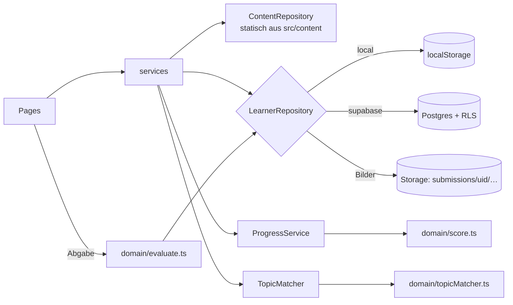

# Architektur – MatheMentor MVP

## 1. Überblick
Tablet-first Single-Page-App (React/Vite/TS). Lerninhalte sind eine **geprüfte, versionierte Wissensbasis** in `src/content` und werden nie von der KI erzeugt. Nutzerdaten liegen in Supabase/Postgres und sind per RLS geschützt. Ohne Supabase-Konfiguration läuft die App automatisch im **lokalen Modus** (localStorage + Mock-Auth), dann komplett ohne Cloud.

## 2. Stack
| Bereich | Wahl | Begründung |
|---|---|---|
| UI | React 19, Vite 8, TypeScript (strict), Tailwind 4 | Vorgabe des Konzepts, schneller Build |
| Routing | react-router 7 | Standard, einfache verschachtelte Layouts |
| Mathe | KaTeX (`MathText`, Inline-`$…$`) | schnell, synchron, kein MathJax-Overhead |
| Backend | Supabase (Auth: E-Mail + Google, Postgres, Storage) | wenig Infrastruktur, RLS serverseitig |
| Tests | Vitest (Domain/Content), PGlite (`npm run db:check`, Schema + RLS) | ohne Cloud lauffähig |

## 3. Ordnerstruktur
```
src/
  types/        content.ts (Wissensbasis), learner.ts (Nutzerdaten), index.ts
  content/      Seed-Wissensbasis: pythagoras.ts (8 Kapitel), prozent.ts, quadratisch.ts, helpers.ts, content.test.ts
  domain/       REINE Logik ohne I/O: evaluate.ts (Antwortprüfung), score.ts (Verständnis-Score), topicMatcher.ts
  services/     types.ts (Interfaces), config.ts (Modus-Wahl), index.ts (Composition Root)
    shared/     staticContentRepository, progressService, topicMatcherService (für beide Modi)
    local/      localAuthService, localLearnerRepository, storage (localStorage, Präfix mathmvp:v1:)
    supabase/   client, supabaseAuthService, supabaseLearnerRepository
  context/      AuthContext (Session)
  components/   AppLayout, ProtectedRoute, MathText, Placeholder(Todo)
  pages/        Landing, Auth(login/register), Dashboard, Topic, Chapter, Exercise, History, Legal, NotFound
supabase/
  migrations/0001_init.sql   Schema, Grants, RLS, Storage-Bucket
  seed.sql                   ERZEUGT aus src/content via `npm run seed:sql`
scripts/  generate-seed.ts, check-db.mjs
```
**Regeln:** Seiten nutzen nur `services.*` und `domain/*`, nie Supabase oder localStorage direkt. `domain/` importiert nichts aus `services/` (abgesehen von Typen).

## 4. Routen
| Route | Seite | Schutz |
|---|---|---|
| `/` · `/login` · `/register` · `/legal/:page` | Landing, Auth, Impressum/Datenschutz/AGB | öffentlich |
| `/app` | Schüler-Dashboard | angemeldet |
| `/app/topics/:topicId` | Themen-Dashboard (Kapitel) | angemeldet |
| `/app/topics/:topicId/chapters/:subtopicId` | Lernkapitel | angemeldet |
| `/app/exercises/:exerciseId` | Aufgabe | angemeldet |
| `/app/history` | Aufgabenhistorie | angemeldet |

`ProtectedRoute` regelt nur die Navigation, Autorisierung passiert per RLS.

## 5. Datenfluss

Aufgabe abgeben: `evaluateAnswer(ex, raw)` → `learner.saveAttempt({…, correction, submission?})` → `progress.get*Progress()` berechnet den Score neu.

## 6. Service-Interfaces (`src/services/types.ts`)
- `AuthService`: `getSession`, `onAuthChange`, `signUpWithEmail` (gibt `null` zurück, wenn eine E-Mail-Bestätigung nötig ist), `signInWithEmail`, `signInWithGoogle`, `signOut`.
- `ContentRepository` (read-only): `listCurricula`, `listTopics` (TopicSummary), `getTopic`, `getSubtopic`, `getExercise`.
- `LearnerRepository` (immer auf `userId` beschränkt): `listActiveTopics`, `addActiveTopic`, `removeActiveTopic`, `saveAttempt`, `listAttempts(filter)`, `getAttempt`, `getSubmissionImageUrl`.
- `ProgressService`: `getSubtopicProgress`, `getTopicProgress`.
- `TopicMatcherService`: `match(query) → MatchResult` (`match` | `ambiguous` | `none`).
- **Modus-Wahl** (`config.ts`): Supabase wird genutzt, wenn `VITE_SUPABASE_URL` mit `http` beginnt und `VITE_SUPABASE_ANON_KEY` länger als 20 Zeichen ist. Mit `VITE_DATA_MODE=local` wird der lokale Modus erzwungen.
- **Entscheidung:** Der Content wird in beiden Modi statisch ausgeliefert, weil er klein, geprüft und offline-fähig ist. Die DB-Tabellen dienen für FKs, Tests und später Eltern/Lehrer. Ein Wechsel auf einen DB-gestützten `ContentRepository` ist eine reine Implementierungsänderung.

## 7. Datenmodell (`0001_init.sql`)
**A) Inhalte** (Text-Slug-IDs, für `authenticated` nur `SELECT`, schreiben darf nur `service_role`):
`curricula → topics → subtopics → {learning_materials, exercises → {solutions (1:1), hints (Level 1–3)}}`, dazu `tests → test_exercises` (sichtbar nur bei `review_status='approved'`).
**B) Nutzerdaten** (UUID, `user_id = auth.uid()`, kein Zugriff für `anon`):
- `profiles`: 1:1 zu `auth.users`, wird per Trigger angelegt, Rolle immer `student`. Der Client darf `role` nicht ändern (Column-Grant).
- `student_topics`: aktive Kacheln.
- `attempts`: **append-only**, kein UPDATE/DELETE. Ein Trigger prüft, dass `topic_id`/`subtopic_id` zur Aufgabe passen.
- `submissions` (+ privater Bucket `submissions/<uid>/<attemptId>.png`), `corrections` (Client darf nur `source ∈ {auto, self}` schreiben).
- `progress`: nur ein Snapshot/Cache. Die Wahrheit sind `attempts` + `score.ts`.
- `test_results`.
- `parent_child`, `teacher_student`, `subscriptions`: angelegt, Client darf **nur lesen (eigene Zeilen)**, geschrieben wird nur serverseitig.
Prüfung: `npm run db:check` (27 Checks: Schema, Seed-Idempotenz, RLS-Positiv/Negativ, Storage).

## 8. Topic-Matching (deterministisch, `domain/topicMatcher.ts`)
1. Normalisieren (Kleinschreibung, ä→ae, ß→ss, `%`→„prozent“, Satzzeichen entfernen), Stoppwörter entfernen.
2. Pro Thema: **+3** je Keyword-Phrase (mehrwortig, exakt), **+1** je Keyword-Token (Präfix-Toleranz ab 5 Zeichen), **+1** bei Treffer im Titel, **+0,5** je Token-Treffer im besten Kapiteltitel.
3. `match`, wenn bester Score ≥ 2 (oder ≥ 1 ohne Konkurrenz) **und** ≥ 1,5 × Zweitbester. Bei mehreren Treffern `ambiguous` (Top 3), sonst `none` mit Vorschlägen. Ein Thema wird **nie** neu erfunden.
4. **Später:** Bei `ambiguous`/`none` optional die Edge Function `match-topic` (KI) aufrufen. Sie bekommt nur die Liste `{id,title,keywords}` und darf nur vorhandene IDs zurückgeben, die serverseitig validiert werden.

## 9. Score-Formel (`domain/score.ts`, Konstanten in `SCORE_CONFIG`)
Pro Versuch: `credit = points × f`, mit `f = 0,25` wenn die Musterlösung vor der Abgabe angesehen wurde, sonst `f = 1 − 0,15 × hintsUsed` (0–3 Hinweise ⇒ 1 / 0,85 / 0,70 / 0,55).
Pro Aufgabe e (Stabilität): `q_e = 0,7 × credit(letzter) + 0,3 × credit(vorletzter)`. Bei nur einem Versuch ist `q_e = credit`, ohne Versuch `q_e = 0`.
Pro Kapitel:
- `M = Σ w_e·q_e / Σ w_e` über **alle** Aufgaben des Kapitels, mit `w = {1: 1, 2: 1,5, 3: 2}` je Schwierigkeit
- `T = |Typen mit q_e ≥ 0,6| / |Typen im Kapitel|`
- `roh = 100 × (0,8·M + 0,2·T)`
- **Deckel** (es gilt das Minimum): `T < 1` ⇒ **max. 79** · keine Aufgabe höchster Schwierigkeit mit q ≥ 0,8 gelöst ⇒ **max. 89** · keine Bestätigung (gleiche Aufgabe zweimal mit credit ≥ 0,8 im Abstand von ≥ 20 h) ⇒ **max. 94**
- `score = round(min(roh, Deckel))`
- Status: kein Versuch ⇒ `not_started` · score ≥ 80 und T = 1 ⇒ `mastered` · ≥ 2 Aufgaben bearbeitet und Ø q < 0,5 ⇒ `needs_practice` · sonst `in_progress`

Thema: `score = round(Ø Kapitel-Scores)` (ungewichtet), `completion = bearbeitete / alle Aufgaben`. Status: alle `not_started` ⇒ `not_started`, alle `mastered` ⇒ `mastered`, eins `needs_practice` ⇒ `needs_practice`, sonst `in_progress`.
Transparenz: `SubtopicProgress.caps` + `CAP_EXPLANATION` erklären dem Schüler die aktiven Deckel, `scoreBand()` liefert die Stufen aus Konzept §13. Testmodus-Attempts zählen im MVP genauso (Phase 2: eigene Gewichtung).

## 10. Erweiterungspunkte
| Feature | Ansatz |
|---|---|
| **Eltern** (Ph. 3) | Edge Function `link-child` (Einladungscode + Einwilligung) schreibt `parent_child`. SQL-Funktionen `is_approved_parent_of(uid)` und `is_approved_teacher_of(uid)` (security definer) bekommen zusätzliche SELECT-Policies auf `attempts`/`progress`. Dashboard liest `progress`-Snapshots. |
| **Lehrer** (Ph. 3) | analog über `teacher_student`, Gruppen zunächst über `group_name`, später eigene Tabelle `groups`. |
| **Foto-Upload** (Ph. 2) | `Submission.kind='photo'`, gleicher Bucket/Pfad. Zuschneiden/Vorschau im Client. Upload-Queue für Offline-Fälle (Entwurf in localStorage). |
| **KI-Korrektur** (Ph. 2) | Edge Function `grade-submission` mit Service-Key auf dem Server: lädt das Bild, ruft die KI auf und schreibt `corrections` (`source='ai'`, `marks` rot/gelb/grün je Schritt). Bei Unsicherheit `verdict='unclear'`, keine Bewertung. Danach sollen `answer`/`solutions` für Clients unsichtbar sein (Bewertung nur serverseitig). |
| **Stripe** (Ph. 3) | Checkout und Customer Portal über eine Edge Function, Webhook `stripe-webhook` schreibt `subscriptions`. Zugriffsprüfung über die SQL-Funktion `has_active_subscription(uid)` in den Policies bzw. Edge Functions. Keine Zahlungsdaten in der DB. |
| **Wiederholung/Empfehlung** (Ph. 4) | Bausteine sind schon da: `attempts.submitted_at` und der Deckel `no-confirmation`. Ein neuer Dienst `RecommendationService` berechnet den nächsten Schritt rein aus Domain-Logik. |

## 11. Annahmen und offene Punkte
- **Annahme:** Lehrplan „DE/Gymnasium Kl. 7–9“ orientiert sich an den KMK-Standards. Länderspezifische Varianten folgen über `curricula`. Die Inhalte brauchen noch eine fachliche Prüfung (`reviewStatus`).
- **Bekanntes MVP-Risiko:** `exercises.answer`/`solutions` sind für angemeldete Nutzer lesbar, und die Bewertung läuft im Client. Ein Schüler könnte also Lösungen auslesen oder Versuche fälschen, schadet damit aber nur dem eigenen Score. Ab Phase 2 wird die Bewertung serverseitig gemacht.
- In `localStorage` passen nur ca. 5 MB, Canvas-Bilder sollten deshalb verkleinert gespeichert werden (JPEG/WebP, ≤ 1200 px).
- Das JS-Bundle ist ca. 616 kB groß (Warnung). Später per Code-Splitting über Routen-`lazy()` verkleinern.
- DSGVO/Einwilligung Minderjähriger, Speicherfristen und KI-Auftragsverarbeitung müssen vor dem Produktivbetrieb rechtlich geprüft werden.
- Die Score-Grenzen (§13) sind Produktentscheidungen und noch pädagogisch zu validieren.
